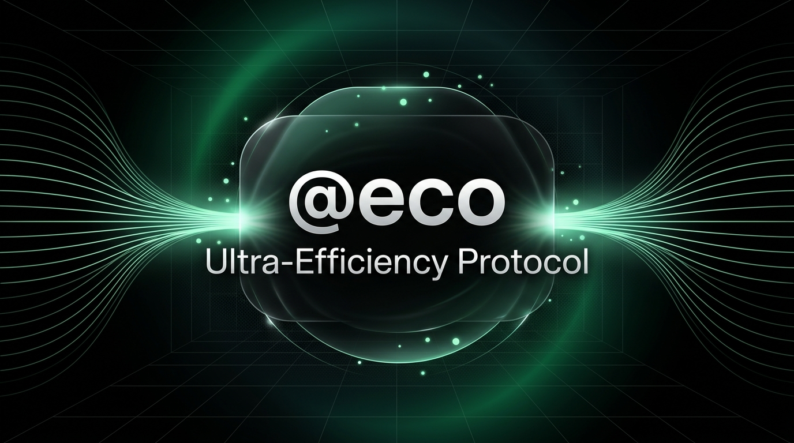
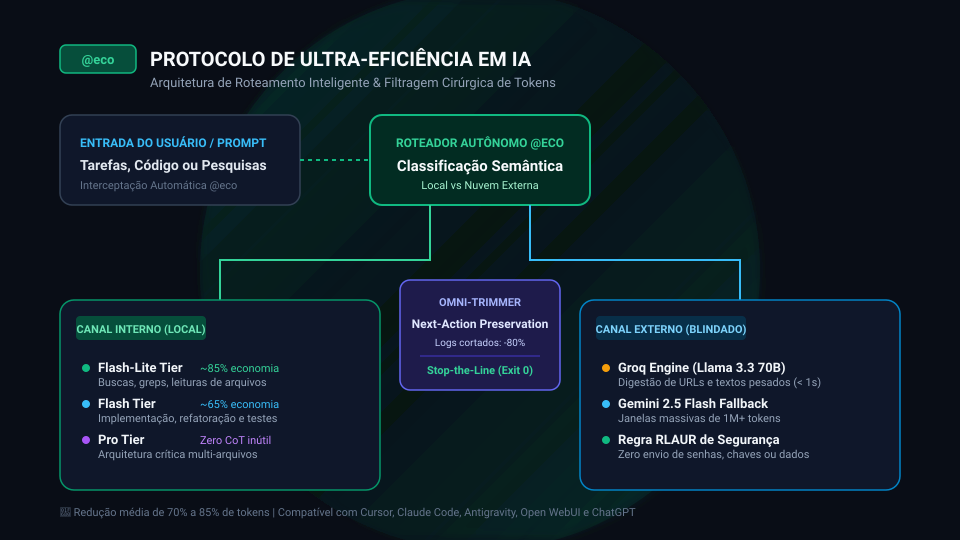

# 🌿 Eco Protocol — Motor Universal de Ultra-Eficiência em IA



O **Eco Protocol** (`@eco`) é um framework de engenharia de contexto, economia computacional e foco executivo para assistentes de IA (Claude Code, Cursor, Antigravity, Open WebUI, ChatGPT). 

Ele reduz o consumo de tokens em **70% a 85%** através de roteamento dinâmico de modelos, corte determinístico de logs de terminal, disciplina sênior de engenharia e **princípios cognitivos anti-paralisia (Executive & ADHD Mode)**.

---

## 🏛️ Arquitetura



O protocolo opera em três vias coordenadas:

1. **Canal Interno (Local)**:
   - **Flash-Lite**: Inspeções de arquivos, buscas cirúrgicas e leituras (~85% de economia).
   - **Flash**: Refatoração, escrita de código e testes (~65% de economia).
   - **Pro**: Arquitetura crítica multi-arquivos sem desperdício de raciocínio verbal.

2. **Canal Externo (Blindado)**:
   - **Groq (Llama 3.3 70B)**: Digestão ultrarrápida de links e páginas externas (< 1s) sem queimar tokens da janela local.
   - **Fallback Gemini 2.5 Flash**: Janelas extensas de 1M+ tokens para lotes volumosos.

3. **Omni-Trimmer (Next-Action Preservation)**:
   - Script local `scripts/trim_output.py` que intercepta logs de compilação, testes e linters, extraindo apenas status, arquivos afetados e linhas de erro, reduzindo o ruído em até 80%.

---

## 🧠 Pilares Cognitivos Anti-Paralisia (Executive & ADHD Focus)

Inspirado em padrões comprovados de redução de sobrecarga cognitiva (como `ayghri/i-have-adhd`):
- **Ação na 1ª Linha (*Lead with Action*)**: Respostas começam diretamente com o código, comando ou diagnóstico. Zero preâmbulos vazios ("Com certeza!", "Ótima pergunta!").
- **Estimativas Concretas em Minutos**: Informa o tempo exato de execuções ou etapas pendentes (`⏱️ ~2 min`), combatendo a cegueira temporal.
- **Teto Curto de Listas (Cap 3 a 5 passos)**: Divide fluxos complexos em micro-passos digestíveis, eliminando a paralisia decisória.
- **Vitórias Visíveis**: Registro constante do que já foi validado (`✅ Concluído: ... | 👉 Próximo: ...`).
- **Erros Factuais e Neutros**: Zero desculpas pedantes; isolamento imediato da causa-raiz e correção com prova.

---

## 📦 Como Instalar e Usar

### Opção 1: Em 1 Linha (Windows PowerShell)
```powershell
Invoke-WebRequest -Uri "https://raw.githubusercontent.com/Coach-Montanha/eco-protocol/main/scripts/install.ps1" -OutFile "$env:TEMP\install.ps1"; & "$env:TEMP\install.ps1"
```

### Opção 2: Em 1 Linha (Linux / macOS)
```bash
curl -fsSL https://raw.githubusercontent.com/Coach-Montanha/eco-protocol/main/scripts/install.sh | bash
```

### Opção 3: Cursor / Claude Code / ChatGPT / Custom Instructions
Copie o conteúdo de [`prompts/eco-protocol.me`](prompts/eco-protocol.me) e cole diretamente nas instruções personalizadas do seu agente ou no arquivo de regras do seu projeto (`AGENTS.md` ou `CLAUDE.md`).

---

## ⚡ Pilares Inegociáveis

- **Zero Conversa Fiada**: Respostas diretas ao ponto, sem preâmbulos ou encerramentos vazios.
- **Edições Cirúrgicas**: Alteração pontual de linhas necessárias em vez de reescrever arquivos completos.
- **Loop com Prova (Stop-the-Line)**: Toda conclusão exige o comando executado e a comprovação de saída com código 0.
- **RLAUR (Segurança)**: Proibição absoluta de envio de chaves de API, senhas ou dados confidenciais para servidores externos.

---

## 📊 Telemetria

Toda resposta do protocolo encerra com um bloco padronizado de telemetria:

```markdown
---
🛠️ **Skills Utilizadas**:
- `/<nome-da-skill>`: Resumo do que executou.

---
📊 **Telemetria de Tokens @eco**:
- **Gasto Real**: ~1.200 tokens
- **Sem Automação**: ~6.500 tokens (fluxo convencional não otimizado)
- **Economia Total**: ~5.300 tokens poupados (~81.5%)
```

---

## 📄 Licença
Distribuído sob licença aberta para uso livre em projetos pessoais e comerciais.
